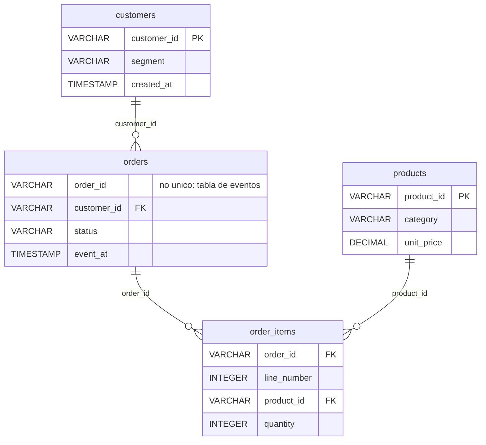

# Catálogo de datos — capa bronze (`raw`)

Catálogo de las 4 tablas crudas del dataset e-commerce, escrito para guiar el diseño de silver y gold. Todas las cifras de estos documentos salen de consultas ejecutadas sobre el archivo; ninguna es estimada.

| Propiedad | Valor |
|---|---|
| Archivo fuente | `data/ecommerce.duckdb` |
| Tamaño | 1323008 bytes |
| SHA-256 | `8e41b059738e3465c82b8020567137889dbd0e223575f1f8e66f24b4cb294a38` |
| Motor / acceso | DuckDB 2.0.0, abierto en modo **solo lectura** |
| Esquemas | `raw` (4 tablas, 0 vistas, 0 índices) |
| Constraints declarados | 0 (ninguna PK, FK, UNIQUE ni NOT NULL; 0 de 27 columnas son NOT NULL) |
| Corte de extracción | `2026-07-01 03:00:00` (`_extracted_at` de `customers` y `products`) |
| Generado | 2026-10-27 |

## Tablas

| Tabla | Filas | Grano | Descripción | Metadatos | Detalle |
|---|---|---|---|---|---|
| `raw.customers` | 600 | 1 fila por cliente | Dimensión de clientes (foto única). | `_extracted_at` | [customers.md](customers.md) |
| `raw.products` | 80 | 1 fila por producto | Dimensión de productos con categoría y precio de lista actual (foto única). | `_extracted_at` | [products.md](products.md) |
| `raw.orders` | 15608 | 1 fila por **evento** de estado de un pedido | Ciclo de vida de 3998 pedidos; incluye 443 eventos re-entregados. | `_ingested_at` | [orders.md](orders.md) |
| `raw.order_items` | 7820 | 1 fila por línea de pedido (`order_id`, `line_number`) | Producto y cantidad de 3993 pedidos; incluye 205 líneas re-entregadas. Sin precio. | `_ingested_at` | [order_items.md](order_items.md) |

### Metadatos de carga: qué tiene cada tabla

| Tabla | `_extracted_at` | `_ingested_at` | Lotes / granularidad de carga |
|---|---|---|---|
| `customers` | Sí: 1 valor (`2026-07-01 03:00:00`) | No | 1 lote de 600 filas |
| `products` | Sí: 1 valor (`2026-07-01 03:00:00`) | No | 1 lote de 80 filas |
| `orders` | No | Sí: 15600 valores distintos | Evento a evento (sin lotes); latencia hasta 47 h 59 min |
| `order_items` | No | Sí: 4105 valores distintos | Por pedido, junto con su evento `created` |

Los metadatos son asimétricos: las dimensiones solo tienen `_extracted_at` y los hechos solo `_ingested_at`. Por eso no se puede evaluar en ninguna tabla el caso `ingested < extracted` ni medir la latencia de extracción a ingesta.

## Relaciones

Diagrama entidad-relación (requiere una extensión de Mermaid en VS Code para renderizarse; si no se ve, la tabla de abajo tiene la misma información):

| Relación | Cardinalidad real | Huérfanos | Lado sin pareja |
|---|---|---|---|
| `orders.customer_id` → `customers.customer_id` | N eventos → 1 cliente (cada pedido tiene un solo cliente) | 0 filas de evento, 0 pedidos, 0 clientes | 198 de 600 clientes (33.00%) sin pedidos |
| `order_items.order_id` → `orders.order_id` | N líneas → 1 pedido (pero `order_id` no es único en `orders`: unir contra el pedido deduplicado) | 0 líneas, 0 pedidos | 5 pedidos (6 filas de evento) sin líneas |
| `order_items.product_id` → `products.product_id` | N líneas → 1 producto | 0 líneas, 0 productos | 0 productos sin ventas |

Claves: `customers.customer_id`, `products.product_id` y (`order_id`, `line_number`) de `order_items` (tras deduplicar) son únicas. En `orders` la clave del evento es (`order_id`, `status`) tras deduplicar. La base no declara ninguna de estas claves ni FK; se verificaron con consultas.

Camino de datos para las preguntas de negocio: `customers` ← `orders` (pedido) → `order_items` → `products`.

## Hallazgos de calidad

Preguntas de negocio: **Q1** clientes (total, activos, crecimiento mensual); **Q2** ventas por día y por semana; **Q3** ingresos (total y por categoría); **Q4** % de pedidos entregados vs cancelados. Orden: de mayor a menor impacto sobre esas preguntas.

| # | Hallazgo | Evidencia | Afecta | Impacto | Acción sugerida |
|---|---|---|---|---|---|
| 1 | `orders` es una tabla de **eventos**, no de pedidos | 15608 filas para 3998 pedidos. `delivered` sobre filas: 22.35%; sobre pedidos: 84.92% (alguna vez) / 81.34% (estado actual). `order_items` unido a eventos crudos: 30729 filas e ingreso 17598914.96 vs 4349000.91 correcto (4.05x). | Q2, Q3, Q4 | Crítico | Modelo de pedido (1 fila por `order_id`) en silver; contar y unir siempre contra él. [Detalle](orders.md) |
| 2 | Eventos y líneas **duplicados** por re-entrega | `orders`: 443 eventos duplicados (2.84% de las filas, siempre 2 copias, mismo contenido). `order_items`: 205 líneas duplicadas (2.62%) en 113 pedidos. Ingreso inflado en 126559.98 (2.91%) si no se deduplica. | Q2, Q3, Q4 | Alto | Deduplicar por (`order_id`,`status`,`event_at`) y (`order_id`,`line_number`) conservando el menor `_ingested_at`. [orders](orders.md), [order_items](order_items.md) |
| 3 | El ingreso **no está en los datos**: `order_items` no trae precio | Ingreso = `quantity * products.unit_price` (precio actual, una sola foto, sin historial). 1014 de 7615 líneas (13.32%) son de productos con `updated_at` posterior al pedido (15.93% del bruto). Sin descuentos, impuestos ni envío; moneda única `USD`. | Q3 | Alto | Documentar el supuesto de precio vigente y validarlo con negocio. [products](products.md) |
| 4 | El **estado actual** de un pedido no existe: hay que derivarlo | Por mayor `_ingested_at` en lugar de `event_at`, cambia el estado de 71 de 3998 pedidos (65 si se deduplica); 61 cancelados quedan como abiertos. 143 pedidos `returned` (pasaron por `delivered`): entregados = 81.34% o 84.92% según el criterio; 169 en vuelo (4.23%) cambian el denominador (88.67% entregados sobre cerrados). | Q4 | Alto | Estado = evento con mayor `event_at` sobre eventos deduplicados; acordar tratamiento de devueltos y en vuelo. [orders](orders.md) |
| 5 | **Llegadas tardías** y cola de datos incompleta | 2774 eventos (17.77%) ingeridos > 1 h tarde, hasta 47 h 59 min. En la cola (desde 2026-06-29 07:32:31): 5 pedidos sin evento `created` (y por eso sin líneas ni ingreso) y 2 `order_id` ausentes (O003986, O003994). Además, 2 pedidos en vuelo superan el plazo máximo observado entre estados. | Q2, Q3, Q4 | Medio-alto | Incremental con marca de agua en `_ingested_at` y ventana de reproceso ≥ 48 h; tratar los últimos 2 días como provisorios. [orders](orders.md) |
| 6 | "Cliente **activo**" no está definido | 198 de 600 clientes (33.00%) no tienen pedidos. Según la definición hay entre 380 y 402 activos. | Q1 | Medio | Acordar la definición (ventana y estados que cuentan) antes de modelar. [customers](customers.md) |
| 7 | Orden físico ≠ orden de eventos | La tabla está en orden de ingesta (0 retrocesos de `_ingested_at`), pero 4107 filas tienen `event_at` menor que la anterior; 600 pedidos recibieron una etapa posterior antes de la anterior. | Q4 | Medio | Ordenar siempre por `event_at`; nunca por posición o por `_ingested_at`. [orders](orders.md) |
| 8 | Timestamps **sin zona horaria** y semanas parciales | Todas las fechas son `TIMESTAMP` naive. Las 27 semanas ISO (lunes) van de 2025-12-29 a 2026-06-29: la primera tiene 4 días con pedidos (el dataset empieza el jueves 2026-01-01) y la última 2 (termina el martes 2026-06-30). | Q2 | Medio | Fijar zona horaria y convención de semana; marcar semanas parciales en gold. |
| 9 | Metadatos de carga **asimétricos** | `customers`/`products` solo `_extracted_at` (1 lote); `orders`/`order_items` solo `_ingested_at` (15600/4105 valores, sin lotes). No se puede evaluar `ingested < extracted`. | Lineage | Bajo | Agregar columnas de carga uniformes en silver. |
| 10 | Sin **constraints** en la base | 0 constraints; 0 de 27 columnas NOT NULL. Hoy: 0 nulos, 0 huérfanos, claves únicas tras deduplicar, pero nada lo garantiza. | Todas | Bajo | Tests de dbt: `unique`, `not_null`, `relationships`, `accepted_values`. |
| 11 | Cantidades bimodales (no es un error) | `retail`: 1–3 unidades (6683 líneas); `wholesale`: 5–20 (932 líneas); el 4 no ocurre. `wholesale` es 15.17% de los clientes y 46.42% del ingreso bruto; `electronics` es 56.08%. | Q3 | Informativo | No filtrar como outliers; considerar `segment` como dimensión. |

### Revisado sin hallazgos

Estos chequeos se ejecutaron y dieron limpio (cada uno validado con un control positivo para descartar que la consulta estuviera rota):

- Nulos: 0 en las 27 columnas de las 4 tablas.
- Espacios en los bordes: 0; strings vacíos: 0; ids que no cumplen su formato (`C#####`, `P####`, `O######`): 0; `status` con mayúsculas: 0.
- Emails inválidos: 0; emails duplicados: 0.
- Precios ≤ 0: 0; cantidades ≤ 0: 0.
- Fechas posteriores al corte: 0 en `customers`, `products`, `orders` y `order_items`; `updated_at` < `created_at`: 0 y 0.
- Huérfanos en las 3 relaciones: 0. Pedidos con `delivered` y `cancelled`: 0.
- Duplicados en `customers` (0) y `products` (0).
- Tipos: fechas son `TIMESTAMP`, precios `DECIMAL(10,2)`, cantidades `INTEGER`; no hay fechas ni números guardados como texto. Los enums (`status`, `segment`, `country_code`, `category`, `currency`) están en `VARCHAR` con valores consistentes.

## Métricas de referencia

Valores calculados con la lógica recomendada, para contrastar los modelos silver/gold. Pedido = `order_id` deduplicado; fecha del pedido = primer evento; corte = `2026-07-01 03:00:00`.

| Métrica | Valor |
|---|---|
| Clientes (total) | 600 |
| Clientes con al menos 1 pedido | 402 |
| Altas del último mes (2026-06) / acumulado | 113 / 600 |
| Pedidos | 3998 |
| Días con pedidos / pedidos por día (mín / máx / promedio) | 181 días / 8 / 43 / 22.1 |
| Semanas ISO con pedidos | 27 |
| Ingreso bruto (todos los pedidos con líneas) | 4349000.91 |
| Ingreso sin pedidos cancelados (estado actual) | 3876787.77 |
| Ingreso de pedidos con estado actual `delivered` | 3502509.72 |
| Ingreso de pedidos alguna vez `delivered` (incluye devueltos) | 3692560.04 |
| % entregados (estado actual) / (alguna vez) / % cancelados | 81.34% / 84.92% / 10.86% |
| Pedidos en vuelo | 169 |

## Lo que no se pudo evaluar

- `ingested < extracted` y latencia de extracción a ingesta: ninguna tabla tiene ambos metadatos. Buscado: columnas `_extracted_at` y `_ingested_at` en `describe` de las 4 tablas.
- Precio efectivo cobrado, descuentos, impuestos, envíos: no hay columnas para eso en `order_items` ni `orders`. Buscado: todas las columnas de las 4 tablas.
- Historial de cambios de clientes y precios: una sola versión por clave y una sola extracción.
- Zona horaria de los timestamps y significado exacto de `created_at`/`updated_at` en `customers`: no hay documentación en la base (sin comentarios ni vistas). Buscado: `duckdb_columns().comment`, `duckdb_tables().comment`, `duckdb_views()`.
- Si los eventos `created` de los pedidos de la cola llegaron después del corte: es una hipótesis coherente con la latencia, no un hecho comprobado.

## Cómo se generó

- Conexión `duckdb.connect(path, read_only=True)` (DuckDB 2.0.0); se verificó que una escritura falla. No se modificó el archivo.
- Cada cifra se obtuvo con una consulta y se interpoló al documento desde un script; las razones porcentuales son aritmética sobre conteos consultados.
- Los chequeos que dieron 0 (huérfanos, `delivered`+`cancelled`, retrocesos de etapa, emails inválidos, etc.) se validaron con controles positivos: la misma consulta, aplicada a una condición que sí debe encontrar casos, devolvió casos.
- Los bloques SQL de `orders.md` y `order_items.md` se ejecutaron tal cual; reproducen 3998 pedidos, 15165 eventos deduplicados, 7615 líneas y un ingreso bruto de 4349000.91.
- Mermaid: el preview integrado de VS Code no renderiza los bloques de código `mermaid` sin una extensión; el resto del catálogo usa solo tablas Markdown.
